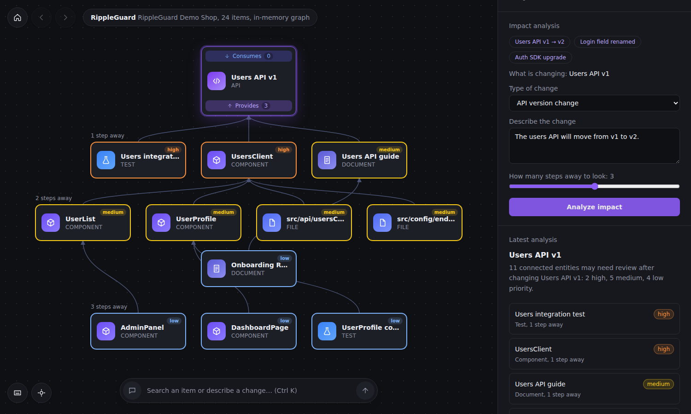

# RippleGuard

**Change one thing in your project. See what else it can affect, and why.**

RippleGuard is a developer tool. You tell it about a change you plan to make, for example "the Users API is moving from v1 to v2". It then shows you every part of the project that is connected to that API: the code that calls it, the tests that check it, the docs that describe it. It also tells you which ones to look at first.

> RippleGuard shows what is *possibly* affected. It does not promise that something will break. It is a checklist generator, not a crystal ball.

---

## 1. The problem in plain words

Software is a web of connected pieces. If you change one piece, other pieces may need updating:

- a button on a web page calls the API you changed
- a test expects the old answer from that API
- a guide for new developers describes the old API

Searching for text finds the direct mentions. It does not show the chain: *API → client code → page → end-to-end test*. RippleGuard follows that chain for you.

## 2. How it works, in 5 steps

Imagine your project is a map of dots (things) joined by lines (how they depend on each other). That map is stored in **Neo4j**, a graph database.

1. **You describe the change.** Pick the thing that is changing (or just type a sentence that names it).
2. **RippleGuard finds the dot** on the map.
3. **It walks backwards along the lines** to find everything that depends on that dot, up to 3 steps away by default. This walk is a Cypher query in Neo4j.
4. **It scores each result.** Close to the change means HIGH, further away means LOW. Critical parts and parts reached by several routes score higher.
5. **It shows the report.** You get a coloured graph, a list of affected items, the exact path for each, and a checklist.

### Example

Change: *Users API v1 becomes v2.*

| Item found | Why it is connected | Steps away | Priority |
|---|---|---|---|
| UsersClient | calls the Users API | 1 | HIGH |
| Users integration test | tests the Users API | 1 | HIGH |
| Users API guide | documents the Users API | 1 | MEDIUM (documents rank one level lower) |
| UserProfile | uses UsersClient | 2 | MEDIUM |
| DashboardPage | uses UserProfile, which uses UsersClient | 3 | LOW |
| BillingPage | not connected to Users API | none | not reported |

Search would have found UsersClient. The graph also finds DashboardPage, three steps away, and shows the path.

## 3. What you will see on screen



The screen works like a map you can explore, with a details panel on the right.

- **The centre card** is the item you are looking at. Its two badges show how many things it **consumes** (uses) and how many it **provides** to (items that depend on it).
- **Above it:** the things it uses. **Below it:** the things that depend on it. Those are the ones a change can reach.
- **Click any card** to move the map to that item. Use Home, Back and Forward (top left) to find your way around.
- **After you analyze a change**, the cards below turn orange (high), yellow (medium) or blue (low), and are grouped by "1 step away", "2 steps away" and so on. Hover a card, or click an item in the right panel, to light up the exact path and fade everything else.
- **The right panel (Details)** shows the item's description, its integrations (click Provides or Consumes to show or hide that side), the change form, the report with its checklist, the evidence path, past analyses, and a metadata table.
- **The search bar at the bottom** (Ctrl K) finds any item by name. If you type a sentence about a change, choose "Analyze … as a change" and RippleGuard works out the target for you.
- **Bottom left:** keyboard shortcuts and "recenter". **Sun/moon button:** dark and light theme. Drag to move the map, scroll to zoom.

## 4. Project map: what each file does

```
rippleguard/
├── backend/                  The Python server (FastAPI)
│   └── app/
│       ├── main.py               Starts the server
│       ├── config.py             Reads settings from the .env file
│       ├── database.py           Talks to Neo4j (or the in-memory backup)
│       ├── schemas.py            Shapes of the data sent in and out
│       ├── routes/               The web addresses (endpoints)
│       └── services/
│           ├── graph_builder.py      Loads and checks the demo data
│           ├── change_parser.py      Understands a typed sentence
│           ├── impact_analyzer.py    Scores and ranks the results
│           └── report_generator.py   Writes the summary and checklist
│   └── tests/                Automatic tests
├── frontend/                 The web page (React)
│   └── src/
│       ├── pages/Dashboard.jsx       The main screen
│       ├── components/               Map canvas, cards, details panel, search bar
│       └── services/api.js           Talks to the backend
├── data/
│   ├── demo_project.json     The sample project (the dots and lines)
│   └── schema.cypher         Neo4j setup and example queries
└── docs/architecture.md      A deeper walk-through
```

## 5. Setup, step by step (Windows PowerShell)

You need Python, Node.js, and ideally a free Neo4j Aura database.

### Run with Docker Compose

With Docker Desktop installed, run this from the repository root:

```powershell
docker compose up --build
```

Open http://localhost:5173. Compose starts the frontend and backend, and uses the built-in in-memory graph by default. To connect Neo4j Aura instead, create a root `.env` from `backend/.env.example`, fill in the Aura credentials, and set `FORCE_MEMORY_GRAPH=false` before starting Compose. The root `.env` is ignored by Git.

**Backend**
```powershell
cd backend
python -m venv .venv
.\.venv\Scripts\Activate.ps1
pip install -r requirements.txt
copy .env.example .env
```
Open `.env` and fill in your Neo4j address, username and password from Aura. Never upload this file to GitHub. If you leave the address empty, RippleGuard uses a built-in backup graph and the screen will say so. Then start the server:
```powershell
uvicorn app.main:app --reload
```
Check http://localhost:8000/health. It should say which graph engine is running.

**Frontend** (open a second terminal)
```powershell
cd frontend
npm install
npm run dev
```
Open http://localhost:5173. The top bar should say **Neo4j** if your database is connected.

## 6. A 2-minute demo

1. Click the example **Users API v1 → v2**, then **Analyze impact**.
2. Point at the graph: purple is the change, orange and yellow are affected, the Billing part is faded out.
3. Click **DashboardPage** and show the three-step path.
4. Click "Yes, it needed changes" on **UserList**, then analyze again. It now ranks higher, because RippleGuard remembers.

## 7. Tests

```powershell
cd backend
pytest
```
The tests check that real dependencies are found, unrelated parts are not, removed links disappear from results, and every path shown is a real connection.

## 8. Short glossary

| Word | Meaning |
|---|---|
| Graph | Dots joined by lines |
| Node | One dot, such as an API, a file or a test |
| Relationship | One line, such as "calls" or "tests" |
| Cypher | The language used to ask Neo4j questions |
| Traversal | Walking along the lines from one dot to others |
| Hop / step | One line travelled during a traversal |
| Evidence path | The chain of lines that explains why something was flagged |

## 9. Limits (be honest about these in your submission)

- The demo project is made up and typed by hand. Reading a real codebase automatically is future work.
- Priority comes from simple rules. It is not a probability of failure.
- If a connection is missing from the graph, the impact is missing from the results.
- There is no login system. Run it locally with the demo data only.

## 10. Ideas for later

Import from GitHub, detect dependencies from code automatically, support database and config changes, run in a CI pipeline, and optionally add an AI model to explain findings in friendly language (the graph would still be the source of truth).
